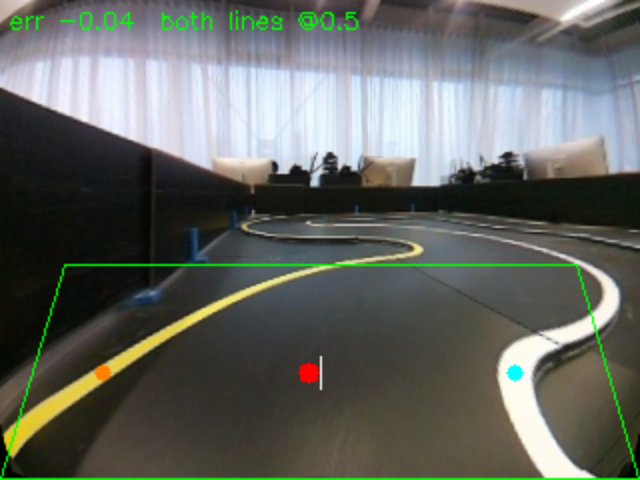

# Camera lane follower (TurtleBot3 Burger)

Classical computer-vision lane following: yellow line on the left, white line on the right.
Camera only, no lidar. Two files:

- `lane_core.py` - detector and steering: HSV thresholds for yellow and white, a trapezoid
  region of interest, several look-ahead rows (the first row that finds a line is used),
  lane centre = halfway between the two lines (or the visible line plus half a lane width),
  error scaled to -1..+1, `angular.z = -kp * error`.
- `lane_node.py` - ROS 2 node. Subscribes to `/camera/image_rect`, publishes `/cmd_vel`,
  `/my_lane/error` and a debug picture `/my_lane/debug`. The robot only moves when the
  parameter `enabled` is true, and it sends a zero command when disabled, on Ctrl+C,
  or after about 0.5 s without any line.

Green trapezoid = region the detector looks at. Orange dot = yellow line, cyan dot = white
line, red dot = lane centre the robot steers toward.

## Run (ROS_DOMAIN_ID=30)
1. Bring up the robot and the camera (see `config/`), then the rectified image:
   `ros2 launch turtlebot3_autorace_camera intrinsic_camera_calibration.launch.py`
2. `python3 own_lane_follow/lane_node.py --ros-args -p image_topic:=/camera/image_rect`
3. Start: `ros2 param set /my_lane_node enabled true`
   Stop: `ros2 param set /my_lane_node enabled false` (or Ctrl+C)
4. View the detector: `rqt` -> Image View -> `/my_lane/debug`

Defaults: speed 0.05 m/s, kp 1.5 (parameters `speed`, `kp`).

## Result
One full lap of the track including the S curve (video: VIDEO_LINK).

## Limits
- Low speed (0.05 m/s); the thresholds are tuned to the lab lighting.
- Proportional control only: in tight curves the robot sits off-centre; in the tightest
  left curve it comes close to the outer line.
- No smoothing of the error.

## Credits
- Camera calibration and rectification: ROBOTIS `turtlebot3_autorace_camera`.
- Written in guided steps with the help of an AI assistant (Claude).
